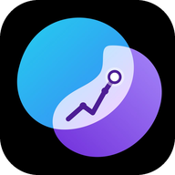
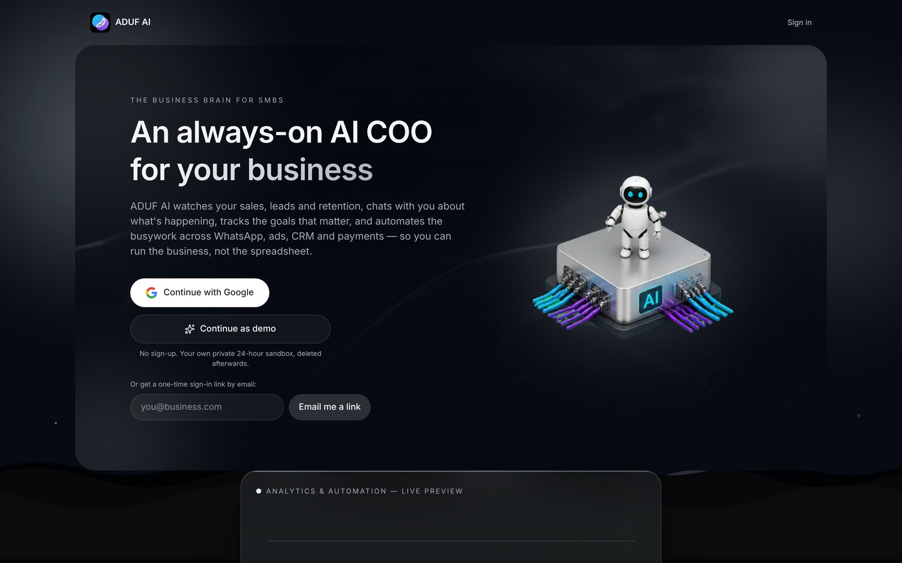
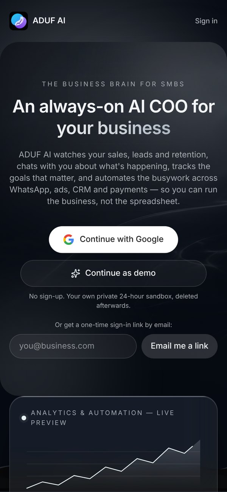

<div align="center">



# ADUF AI

**An always-on AI COO for small and medium businesses.**
It watches your sales, leads and retention, talks to you about what is happening, tracks your goals, and automates the busywork across ads, CRM, payments and messaging.

[](LICENSE)
[](tsconfig.json)
[](https://tanstack.com/start)
[](https://supabase.com)
[](https://github.com/Oluwafemi27/liquid-brain/actions/workflows/e2e.yml)
[](https://github.com/Oluwafemi27/liquid-brain/actions/workflows/deploy-azure.yml)

[**Live app**](https://liquid-brain.vercel.app) · [Architecture](docs/ARCHITECTURE.md) · [Security](docs/SECURITY.md) · [Docs index](#documentation)

</div>

<p align="center">
  
</p>

## Try it in one click

Open the [live app](https://liquid-brain.vercel.app) and choose **Continue as demo**. You get your own private 24-hour sandbox: no sign-up, nothing shared with other visitors, and everything is deleted when the visit ends. Demo accounts can't connect external services. See [docs/DEMO-AND-LIMITS.md](docs/DEMO-AND-LIMITS.md).

## What it does

| | |
|---|---|
| **Brain chat** | Ask the business anything. The agent reads your connected data, shows its steps, asks before it acts, and can undo what it did. |
| **Goals engine** | Set KPIs and sub-tasks, track progress, and let the agent plan the next step. |
| **Automations** | Turn automations on and off without code, or have the agent build n8n workflows that need no credential setup. |
| **Business memory** | A knowledge graph of customers, products, revenue and traffic, built from your data. |
| **Analytics and what-if** | Charts, scheduled reports, and a simulator for questions like "what if I raise ad spend by ₦50k?". |
| **Connectors** | Google Analytics, Sheets, Drive and Gmail, Telegram, Meta Ads, Shopify and Paystack, through OAuth or [Composio](https://composio.dev). |
| **Skills** | Business analyst (pandas in a sandbox), competitor spy, dropshipping, Meta ads operator (read-only). See [docs/SKILLS.md](docs/SKILLS.md). |
| **Plans and limits** | Credits, per-hour and per-day reply limits, usage meters and clear notices before a limit is hit. See [docs/BILLING.md](docs/BILLING.md). |

### Built to be trusted with business data

- **Per-user privacy.** Each account's model keys, connections, chats and notifications are private to that account.
- **Approvals, limits and undo.** Risky actions wait for your approval, and the server enforces limits, not the browser ([docs/TRUST-LAYER.md](docs/TRUST-LAYER.md)).
- **Uploads are scanned and short-lived.** Files are virus-scanned, originals are deleted within 24 hours, and large media is discarded after reading ([docs/CHAT-ATTACHMENTS.md](docs/CHAT-ATTACHMENTS.md)).
- **Secrets are encrypted** at rest. See [docs/SECURITY.md](docs/SECURITY.md).

<p align="center">
  
</p>

The interface is mobile-first and installable as a PWA, with a left sidebar on desktop and a bottom tab bar on phones.

## Tech stack

| Layer | Choice |
|---|---|
| App | [TanStack Start](https://tanstack.com/start) (React 19, TypeScript, Vite), Tailwind CSS, Radix UI, Framer Motion, Recharts |
| State | Zustand |
| Data and auth | Supabase (Postgres, Auth, Realtime, Storage) |
| Shared limits and caches | Redis (optional): ioredis or Upstash REST |
| AI | Pluggable model providers, keys stored per user |
| Integrations | OAuth, Composio, n8n, Paystack |
| Monitoring | Sentry, Datadog RUM |
| Hosting | Vercel or Azure Container Apps, the same code on both |
| Tests | Node test scripts for the server logic, Playwright smoke tests at four screen sizes |

## Getting started

Requirements: Node.js 22 and a Supabase project.

```sh
git clone https://github.com/Oluwafemi27/liquid-brain.git
cd liquid-brain
npm install
cp .env.example .env     # then fill in the values below
npm run dev
```

Apply the SQL files in [`supabase/migrations`](supabase/migrations) in order to your Supabase project.

### Minimum configuration

| Variable | Purpose |
|---|---|
| `VITE_SUPABASE_URL`, `VITE_SUPABASE_ANON_KEY` | Browser sign-in |
| `SUPABASE_URL`, `SUPABASE_SERVICE_ROLE_KEY` | Server database access. Keep the service role key secret. |
| `TOKEN_ENCRYPTION_KEY` | Encrypts stored tokens and keys |
| `APP_URL` | Public https origin, used for OAuth redirects and emails |
| `CRON_SECRET` | Protects the scheduled job endpoints |

Everything else (Redis, Resend, Sentry, Datadog, Composio, Paystack, model providers) is optional and documented in [`.env.example`](.env.example) and [docs/CONNECTORS.md](docs/CONNECTORS.md).

## Scripts

| Command | What it does |
|---|---|
| `npm run dev` | Start the dev server |
| `npm run build:node` | Production build for a Node server (`.output/`) |
| `npm test` | Run the server-logic test suites |
| `npm run test:e2e` | Browser smoke tests (see [docs/TESTING.md](docs/TESTING.md)) |
| `npm run lint` | ESLint |

## Deployment

The same build runs on **Vercel** (serverless) or **Azure Container Apps** (containers, with autoscaling and a per-server AI load gate). The Azure path ships with a GitHub Actions workflow and a Dockerfile. Scheduled jobs (daily checks, hourly cleanup of expired files and demo sessions) run from GitHub Actions or Vercel Cron.

- [docs/AZURE.md](docs/AZURE.md): deploy to Azure
- [docs/SCALING.md](docs/SCALING.md): how it handles many users
- [docs/MONITORING.md](docs/MONITORING.md): Sentry and Datadog

## Documentation

| Topic | File |
|---|---|
| How it works | [ARCHITECTURE.md](docs/ARCHITECTURE.md) |
| Plans, credits, payments | [BILLING.md](docs/BILLING.md) |
| Demo mode and usage limits | [DEMO-AND-LIMITS.md](docs/DEMO-AND-LIMITS.md) |
| Connectors | [CONNECTORS.md](docs/CONNECTORS.md) |
| Skills | [SKILLS.md](docs/SKILLS.md) |
| n8n without credential setup | [N8N-CREDENTIALLESS.md](docs/N8N-CREDENTIALLESS.md) |
| Approvals, undo, privacy | [TRUST-LAYER.md](docs/TRUST-LAYER.md) |
| Security | [SECURITY.md](docs/SECURITY.md) |
| Testing | [TESTING.md](docs/TESTING.md) |

## Contributing

Issues and pull requests are welcome. Before opening a pull request, run `npm run lint`, `npx tsc --noEmit` and `npm test`. To report a security problem, please email the maintainer instead of opening a public issue.

## License

Released under the [MIT License](LICENSE). Copyright © 2026 Oluwafemi27.
